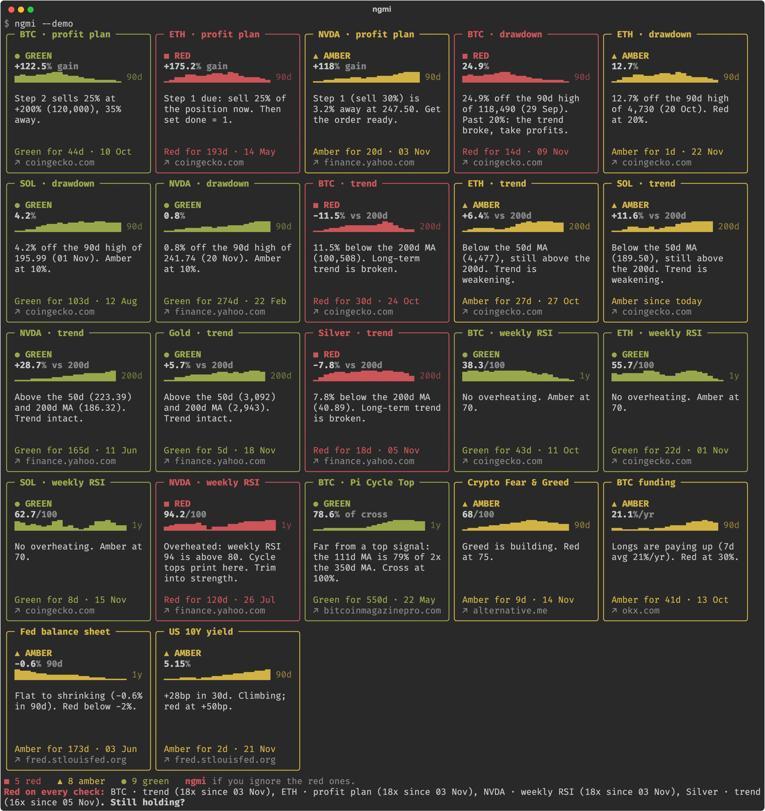

# ngmi

**Not gonna make it**, unless you take profits.

`ngmi` is a terminal dashboard of objective exit signals: a grid of square tiles, each
green, amber or red, with a sparkline, a plain-language rule and how long it has been in that state.
It's meant for people who are good at spotting uptrends but hold too long.



> Not financial advice. These are rules of thumb that you configure yourself.

## Install

Not on PyPI yet, so install from a clone. Needs [uv](https://docs.astral.sh/uv/).

```bash
git clone <this repo> ngmi && cd ngmi
uv tool install --editable .   # puts `ngmi` on your PATH; code changes apply without reinstalling
ngmi init                      # writes ~/.config/ngmi/config.toml
ngmi
```

Try it without any setup: `uv run ngmi --demo`.

## Usage

| Command        | What it does                         |
| -------------- | ------------------------------------ |
| `ngmi`         | Show all signal tiles                |
| `ngmi --json`  | Same, as JSON (pipe it anywhere)     |
| `ngmi --demo`  | Built-in mock data, no network       |
| `ngmi --cols 4`| Force tiles per row (default: fit the terminal, max 5) |
| `ngmi signals` | List signals and whether they're on  |
| `ngmi history` | Each signal's color per day, from the local log |
| `ngmi --no-log`| Don't record this run                |
| `ngmi init`    | Write a starter config               |

## Config and keys

Everything runs locally. Thresholds and positions live in `~/.config/ngmi/config.toml`.
No API keys are needed: every source has a free public endpoint.

## Signals

| Tile                    | Source         | Red when                                     |
| ----------------------- | -------------- | -------------------------------------------- |
| Profit plan (per plan)  | CoinGecko / Yahoo | one of your take-profit steps is reached  |
| Drawdown (per position) | CoinGecko / Yahoo | 20%+ below the rolling 90-day high        |
| Trend (positions + watch) | CoinGecko / Yahoo | price below the 200-day MA (amber: below the 50-day) |
| Weekly RSI (per position) | CoinGecko / Yahoo | weekly RSI above 80                     |
| BTC Pi Cycle Top        | Yahoo (BTC-USD) | 111-day MA crosses 2x the 350-day MA        |
| Attention (per page)    | Wikipedia pageviews | 7-day views 3x+ the 1-year median (amber: 2x) |
| Crypto Fear & Greed     | alternative.me | 75+ (extreme greed)                          |
| BTC funding             | OKX            | 7-day average funding 30%+/yr                |
| Liquidity               | FRED (WALCL or M2SL) | down 2%+ over 90 days                  |
| US 10Y yield            | FRED (DGS10)   | up 50bp+ in 30 days                          |
| VIX                     | Yahoo (^VIX)   | below 15 (amber: below 17); the rule names the zone |

Every threshold and window is configurable. `[positions]` are what you hold (drawdown +
trend tiles); `[watch]` is context like gold and silver (trend tiles only).

## Attention

A Google Trends-style read on retail interest, using daily pageviews of the English Wikipedia
pages for Bitcoin and Cryptocurrency (Wikimedia's free API; Google Trends has no public one).
When people who don't usually care about crypto start looking it up, the crowd is late.
Since 2015, the Bitcoin page's 7-day average hit 5–10x its 1-year median at the 2017 and
2021 tops and about 3x in 2024, while the 2020 and 2022 crashes stayed near 1x. Add any
page title to `articles`.

## VIX zones

The VIX tile is based on [@AskLivermore](https://x.com/AskLivermore)'s "VIX Cheat Sheet"
(posted on X, 7 July 2026). The VIX measures how much protection traders are buying, so
it's a fear gauge: the idea is to buy when others panic and get careful when nobody worries.
Paraphrasing the post:

| VIX      | Zone     | What to do                                                     |
| -------- | -------- | -------------------------------------------------------------- |
| 35+      | Buy      | Buy aggressively: high-beta tech, growth, small caps. Per the author, every spike above 35 since 2018 (the COVID low, the October 2022 low, the tariff crash) was a great buying opportunity. |
| 25–35    | Scale in | Fear is real, but the opportunity is bigger. Build positions gradually, not all at once: quality tech, financials, industrials, cyclicals. |
| 15–25    | Hold     | Normal conditions. Stay positioned in tech plus defensives and dividend growers; don't chase and don't panic. |
| below 15 | Sell     | Everyone is comfortable and nobody hedges, which is exactly when to worry. Reduce exposure and rotate to utilities, healthcare, staples and bonds. The author argues that major crashes were preceded by weeks of VIX below 15. |

Those historical claims are the author's, not something ngmi checks. Because ngmi is about
exits, only the sell zone turns the tile red (amber just above it, below 17). The tile's
text names the current zone and its sectors, and "Red for Nd" shows how many weeks the VIX
has been sitting below 15.

## Take-profit plans

Decide your exits while you're calm, not in the moment. Add a plan per position:

```toml
[plans.bitcoin]
entry = 40000
done = 0          # bump this after you sell a step
steps = [
  { gain = 100, sell = 20 },   # at +100%, sell 20% of the original position
  { gain = 200, sell = 25 },
  { gain = 300, sell = 25 },
]
```

The plan tile turns amber when the next step is within 10% and red when it's due,
with exactly what to sell.

## History

Each run saves the day's colors to `~/.local/share/ngmi/history.jsonl` (one entry per
day). `ngmi history` shows the last 30 days per signal, and the dashboard calls out
anything that has been red on 3+ checks in a row. Use `--no-log` to skip.

## Adding a signal

1. **Adapter** (`src/ngmi/adapters/`): fetch a source and return a daily `pandas.Series`.
   Adapters are injected through `Sources` (`sources.py`), so tests and `--demo` swap in
   the mocks from `adapters/mock.py`.
2. **Rule** (`src/ngmi/rules/`): a pure function `(series, config) -> Signal`. Use
   `rules.base.state_since` to compute how long it has been in its current status.
3. **Config**: add a thresholds model in `config.py` and defaults in `default_config.toml`.
4. **Register** it in `registry.py`, and add tests. Use synthetic data, never recorded
   API responses: add a builder to `tests/fixtures/generate.py` and rerun it.

## Development

```bash
uv sync
uv run pytest
uv run ngmi
```
# ngmi
